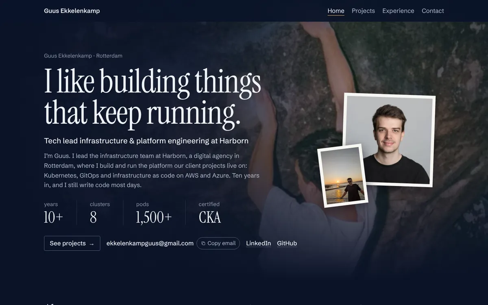

# ekkelenkamp.dev



## Stack, and why

|                                               |                                                                                                                                                                              |
| --------------------------------------------- | ---------------------------------------------------------------------------------------------------------------------------------------------------------------------------- |
| **Astro 7**, static, TypeScript strict        | Every page is pre-rendered HTML. No UI framework; about 17 KB of script on the heaviest page. ([ADR 0001](docs/adr/0001-static-astro.md))                                    |
| **Design tokens** (DTCG → Style Dictionary 5) | One token edit restyles the site, drawings included. ([0002](docs/adr/0002-design-tokens.md))                                                                                |
| **Build-time SVG + a tiny motion runtime**    | The drawings are complete without JavaScript; the runtime only moves them, on one shared animation loop. ([0003](docs/adr/0003-build-time-svg-and-a-tiny-motion-runtime.md)) |
| **Native CSS** with cascade layers            | Scoped component styles, fluid type, no Tailwind.                                                                                                                            |
| **Self-hosted fonts** (Fontsource)            | Instrument Serif, Schibsted Grotesk, Geist Mono, with metric-matched fallbacks.                                                                                              |
| **A strict CSP**                              | Hash-based, Trusted Types on, no inline styles. ([0006](docs/adr/0006-strict-csp.md))                                                                                        |
| **No analytics, no cookies**                  | ([0005](docs/adr/0005-no-analytics.md))                                                                                                                                      |

## How it ships

```
git push → ci.yml (lint, types, unit, e2e, axe, Lighthouse) → release.yml
         → ghcr.io/guuse/portfolio:<sha>  (nginx, non-root, read-only)
         → Argo CD Image Updater commits the tag → Argo CD syncs → k3s
         → Traefik → Cloudflare Tunnel → https://ekkelenkamp.dev
```

The same flow the [homelab case study](https://ekkelenkamp.dev/projects/homelab/) describes,
running on the machine it describes. Details: [ADR 0004](docs/adr/0004-hosting-on-the-homelab.md)
and [`infrastructure/README.md`](infrastructure/README.md).

## Run it

```bash
nvm use          # Node 22
npm ci
npm run dev      # http://localhost:4321
```

| Script                    |                                                                     |
| ------------------------- | ------------------------------------------------------------------- |
| `dev`, `build`, `preview` | Astro, with the tokens built first                                  |
| `tokens`                  | `tokens/` → `src/styles/tokens.{css,ts}`                            |
| `lint`, `lint:css`        | ESLint (TypeScript, Astro, jsx-a11y), Stylelint                     |
| `format`, `format:check`  | Prettier                                                            |
| `typecheck`               | `astro check`                                                       |
| `test`                    | Vitest: maths, scheduler, tokens and contrast, content, the kit     |
| `test:e2e`, `test:a11y`   | Playwright against `astro preview`; axe on every page (build first) |
| `check`                   | everything fast, before you push                                    |
| `assets`                  | re-render the favicons and social cards (Playwright)                |
| `coffee`                  | please don't                                                        |

Lighthouse runs in CI with the budget in [`lighthouserc.cjs`](lighthouserc.cjs): 95+ in every
category on every page, mobile. Locally: `npm run build && npx lhci autorun`. Set
`CHROMIUM_PATH` (Playwright) or `CHROME_PATH` (Lighthouse) to use a Chromium you already have.

## Where things are

```
src/
  pages/            routes: /, /projects/, three case studies, /design-system/, 404, *.txt
  components/       layout, ui, home, projects, case (scenes, steps, lightbox, lessons), art
  content/          the copy you'd edit: experience, skills, projects… (YAML + zod schemas)
  lib/art/          the illustration kit and every scene, rendered to SVG at build time
  lib/motion/       the scheduler, packets and one animator per scene
  scripts/          page behaviour: copy email, prints, reveal, lightbox, the small extras
  styles/           layers, base styles, the kit's materials; tokens.* are generated
tokens/             design tokens (primitive → scale → theme)
tests/              unit (Vitest), e2e and a11y (Playwright + axe)
integrations/       one Vite plugin: the cascade layer order in every stylesheet
scripts/            token build, brand assets
docs/adr/           why it's built this way
design/             the archive: 17 rounds of mocks this was ported from
infrastructure/     the container and the Kustomize app Argo CD syncs
```

The design system is a page, not a document: [/design-system/](https://ekkelenkamp.dev/design-system/)
renders the tokens, type, components, easing curves and the kit from the same source as the
site. How the design came about is in [`design/README.md`](design/README.md).

## Licence

Code: [MIT](LICENSE). The writing, photos, screenshots and illustrations are © Guus
Ekkelenkamp, all rights reserved. AWS Architecture Icons and Simple Icons keep their own
licences (in `src/assets/icons/`). Security reports: [SECURITY.md](SECURITY.md).
